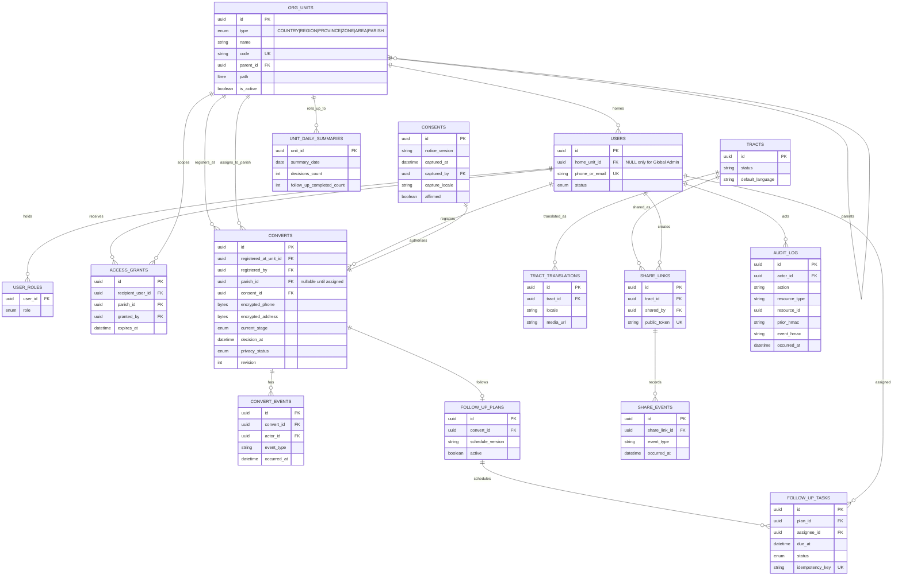

# Go-Ye initial ERD

**Status:** Phase 0 logical model only. No schema migration exists yet and no real data may be stored.

The diagram establishes the entities and ownership boundaries required before the Phase 1 migration design. It is deliberately implementation-neutral: every physical table, constraint, index, row-level-security policy and rollback note will be introduced by versioned migration.

## Mandatory physical-model constraints for Phase 1

- `org_units` permits only `COUNTRY > REGION > PROVINCE > ZONE > AREA > PARISH`; migrations must reject invalid parent types and cycles.
- `path` uses an indexed `ltree` label derived from stable IDs. Unit moves rebuild the entire affected subtree transactionally and write an audit event.
- A convert has one `registered_at_unit_id` and one `registered_by`; `parish_id` may be null only while unassigned. Assignment creates/activates the parish follow-up plan.
- A positive consent record and consent metadata must exist before a convert insert is accepted.
- Phone/address ciphertext, not plaintext, is stored. Protected duplicate matching and key rotation need their own reviewed design.
- Audit records omit PII and form a verifiable HMAC chain.
- Summaries are derived/incremental facts; they are never the sole source of convert truth.
- RLS and API query predicates enforce home-unit-plus-descendant access. Above-parish detail reads create audit records in the same transaction.
